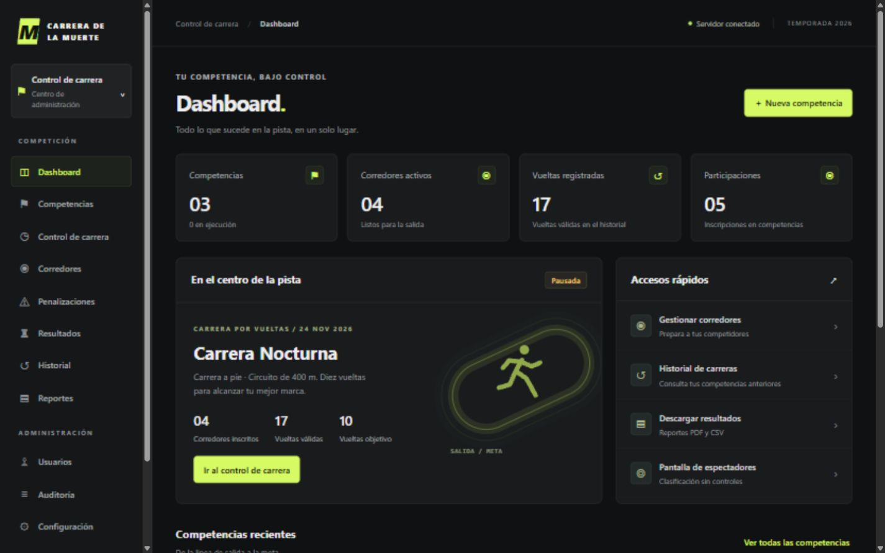

# Carrera de la Muerte — Carreras a pie

Aplicación web para organizar competencias de personas que corren. Administra corredores, dorsales, equipos, categorías, distancias, vueltas, tiempos, penalizaciones y resultados. Incluye acceso para organizadores y operadores, además de una clasificación pública.



La imagen muestra una demostración con personas y competencias ficticias. La base real comienza sin datos de ejemplo.

## Iniciar desde Visual Studio Code

Requisitos: Node.js 20.19+ o 22.12+ y npm. Abre una terminal en la carpeta del proyecto:

```powershell
npm install
npm run dev
```

Entra a [la aplicación](http://127.0.0.1:5173). El comando inicia el frontend en 5173 y la API en 3001. Detén ambos con Ctrl+C. Live Server o abrir el HTML directamente no ejecuta la aplicación completa.

En el primer acceso crea tu cuenta de administrador con nombre, correo y contraseña de al menos 10 caracteres, máximo 72 bytes. La instalación real no incluye contraseñas predeterminadas.

## Organizar una carrera

1. En **Corredores**, registra nombre completo, equipo o club y categoría. El equipo es opcional; se asigna «Independiente» si lo dejas vacío.
2. Crea una competencia con fecha, modalidad y distancia de cada vuelta en metros. Para una pista estándar puedes configurar 400 m; para un circuito distinto introduce su longitud real.
3. Define las vueltas objetivo o el tiempo de resistencia. Por ejemplo, 5 vueltas de 400 m equivalen a 2 km.
4. Abre **Control de carrera** e inscribe al menos dos corredores. Asigna un dorsal único dentro de esa competencia.
5. Inicia el cronómetro. Registra una vuelta cada vez que la persona cruce la línea de control. Puedes pausar y reanudar.
6. Registra las incidencias justificadas, finaliza la carrera y consulta la clasificación. Descarga PDF/CSV y archiva la competencia.

Una persona puede participar en distintas competencias. No puede inscribirse dos veces en la misma, ni compartir dorsal con otra persona en esa carrera. Solo participan corredores activos.

## Módulos

| Pantalla | Funciones |
| --- | --- |
| Dashboard | Totales de corredores, competencias, participaciones y vueltas |
| Corredores | Registro, búsqueda por nombre/equipo/categoría/dorsal, edición y baja lógica |
| Competencias | Fecha, reglas, modalidad, distancia por vuelta e inscripciones |
| Control de carrera | Cronómetro, vueltas, distancias, ritmo, posiciones y parciales |
| Penalizaciones | Tiempo añadido, retiro, eliminación y descalificación con motivo |
| Resultados | Clasificación, estadísticas y podio cuando existe ganador oficial |
| Historial | Consulta por competencia, fecha, persona y estado |
| Reportes | Resultados PDF y CSV con datos de los corredores |
| Usuarios | Cuentas, permisos y desactivación de acceso |
| Auditoría | Responsable, fecha, motivo y evidencia de operaciones críticas |
| Configuración | Nombre de la organización, sede, temporada y respaldos |
| Vista pública | Cronómetro y clasificación sin controles de escritura |

## Modalidades y medición

| Modalidad | Condición de victoria |
| --- | --- |
| Por vueltas | Completar el objetivo con el menor tiempo ajustado |
| Contrarreloj | Completar el mismo objetivo y comparar el tiempo ajustado |
| Resistencia | Más vueltas válidas al terminar el periodo configurado |
| Eliminación | Ser el último corredor habilitado; las eliminaciones las registra el operador |

El servidor calcula las duraciones a partir de marcas acumuladas y descuenta las pausas. La distancia recorrida es `vueltas válidas × metros por vuelta`. El ritmo mostrado es el tiempo ajustado por kilómetro e incluye las penalizaciones de tiempo.

El orden general considera vueltas válidas, tiempo ajustado y mejor vuelta; los participantes excluidos no reciben posición competitiva. Un empate pendiente con vueltas requiere resolución justificada del administrador antes de oficializar al ganador.

No se capturan tiempos mientras la carrera esté pausada o cerrada. Reiniciar crea otro intento y conserva el anterior. Corregir o anular una vuelta exige administrador y motivo; se recalculan los parciales posteriores y se conserva la evidencia. Reabrir resultados finalizados también requiere autorización y justificación. Las competencias archivadas permanecen cerradas.

La captura es manual: el tiempo corresponde al procesamiento en el servidor y puede verse afectado por la red. Las actualizaciones usan SSE, sincronización periódica y consultas de respaldo si se pierde el canal. Para consultar como espectador abre [la vista pública](http://127.0.0.1:5173/#public).

## Roles

| Rol | Acceso |
| --- | --- |
| Administrador | Corredores, competencias, inscripciones, resultados, usuarios, auditoría, configuración y respaldos |
| Operador | Registro/edición de corredores, cronómetro, vueltas, incidencias, resultados y reportes |
| Espectador | Consulta de clasificación pública sin cuenta |

Los corredores son participantes, no cuentas de acceso. La organización crea las cuentas de operadores desde **Usuarios**.

## Demostración independiente

```powershell
npm run demo
```

Abre [la demostración](http://127.0.0.1:5174):

- Correo: `demo@carrera.local`
- Contraseña: `CarreraDemo2026`

Incluye cuatro corredores, sus clubes/categorías y tres competencias a pie. Usa una API separada en 3002 y SQLite en memoria. No abre la base real y sus cambios desaparecen al detenerla.

## Comandos

| Comando | Función |
| --- | --- |
| `npm install` | Instalar dependencias de ambos workspaces |
| `npm run dev` | Iniciar frontend y backend |
| `npm run dev:backend` | Iniciar únicamente la API de desarrollo |
| `npm run dev:frontend` | Iniciar únicamente la interfaz de desarrollo |
| `npm run demo` | Demostración temporal |
| `npm test` | Pruebas de integración con bases temporales |
| `npm run build` | Comprobar TypeScript y compilar el frontend |
| `npm start` | Servir la API y el frontend previamente compilado |

Para usar la compilación en un solo servidor:

```powershell
npm run build
npm start
```

Abre [la aplicación compilada](http://127.0.0.1:3001).

## Datos, cuentas y respaldos

La base persistente está en `backend/data/carrera.sqlite`. Utiliza tablas relacionadas para corredores e inscripciones; el modelo de competencia no exige ningún equipo físico. Los dorsales y las inscripciones se protegen con restricciones únicas, claves foráneas y transacciones.

Las instalaciones anteriores se adaptan automáticamente: se conservan las personas, inscripciones, marcas y resultados, además de sus tablas originales como evidencia. No se inventan distancias históricas: si antes no se configuraban, se muestran sin distancia ni ritmo hasta que las reglas permitan configurarlas. El historial V1 sin identificación de intentos se conserva como evidencia archivada, sin generar duraciones ficticias.

Las contraseñas se guardan con bcrypt, coste 12. Las sesiones duran ocho horas, con tokens cuyo hash se almacena en SQLite y cuyo valor se mantiene en `sessionStorage`. Los permisos se comprueban en el servidor. Cerrar sesión, cambiar contraseña o editar permisos revoca sesiones. El inicio de sesión limita intentos repetidos.

Desde **Configuración** puedes descargar un respaldo lógico JSON, formato 3 para carreras a pie, y restaurarlo. Se admiten respaldos anteriores de formato 2 mediante conversión. La restauración valida datos, referencias y tiempos, guarda una copia previa en SQLite, reemplaza la información activa y cierra sesiones. Las carreras que estaban corriendo se restauran pausadas. Los respaldos contienen cuentas y hashes de contraseñas: guárdalos de forma privada. Las copias previas internas se recuperan con herramientas SQLite; no existe un botón para esa recuperación.

## Variables opcionales

Se leen del entorno del proceso. `.env.example` es una referencia y no se carga automáticamente.

| Variable | Valor predeterminado |
| --- | --- |
| `HOST` | `127.0.0.1` |
| `PORT` | `3001` |
| `DB_PATH` | `backend/data/carrera.sqlite` |
| `FRONTEND_ORIGIN` | `http://localhost:5173` |
| `API_PROXY` | `http://127.0.0.1:3001` |

Ejemplo en PowerShell: `$env:PORT='3005'` antes de `npm start`. Si cambias el puerto del backend durante el desarrollo, ajusta también `API_PROXY` para Vite.

## Estructura

```text
backend/
  scripts/demo.mjs          # Personas y competencias ficticias
  src/app.js               # HTTP, seguridad y frontend compilado
  src/db.js                # Conexión SQLite
  src/repository.js        # Persistencia de corredores y competencias
  src/running-migration.js # Compatibilidad con datos anteriores
  src/v2.js                # API y reglas de competencia
  src/server.js            # Arranque del servidor
  test/v2.test.js          # Pruebas de integración
frontend/src/              # Pantallas, formularios, clasificación y estilos
scripts/dev.mjs            # Arranque conjunto
docs/                      # Documentación y vista previa
```

## Comprobaciones y límites

Ejecuta `npm test` y `npm run build`. Las pruebas cubren autenticación, roles, inscripciones por persona, dorsales, distancias, ritmo, estados, cronómetro, idempotencia, intentos, sanciones, resultados, exportaciones, respaldos y migración. No escriben en la base real.

La interfaz está preparada desde 360 px; las tablas se desplazan dentro de su contenedor. Las metas de carga, disponibilidad, precisión temporal y WCAG AA necesitan validación específica. La publicación en red requiere HTTPS y configuración del servidor. Los respaldos son manuales.
