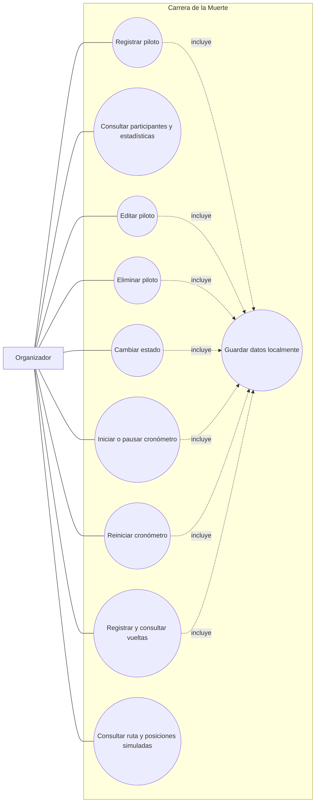

# Casos de uso

## Actores

- **Organizador:** registra y administra participantes y controla la carrera.
- **Aplicación:** valida entradas, mantiene estadísticas, presenta el cronómetro y persiste los cambios en el navegador.

## Diagrama de casos de uso

## UC-01 — Registrar piloto

**Actor:** Organizador. **Precondición:** la página está abierta.

1. Ingresa nombre, alias y número.
2. Envía el formulario.
3. La aplicación comprueba que los campos estén completos, que el número esté entre 0 y 999 y que no esté asignado.
4. Si los datos son válidos, crea el piloto activo, guarda los datos y actualiza la cuadrícula y las estadísticas.

**Alternativas:** si falta un campo, el número no es válido o ya está ocupado, la aplicación informa el error y conserva el formulario para corregirlo.

## UC-02 — Editar piloto

1. El organizador pulsa **Editar** en una tarjeta.
2. La aplicación carga los datos en el formulario.
3. El organizador cambia los valores y guarda.
4. La aplicación valida número único, conserva estado y vueltas, persiste y actualiza la tarjeta.

**Alternativa:** **Cancelar** descarta los cambios pendientes.

## UC-03 — Cambiar estado

1. El organizador elige un estado en la tarjeta.
2. La aplicación persiste el nuevo estado, recalcula estadísticas y ordena la lista: activo, penalizado, ganador, eliminado.
3. Al marcar como eliminado, destaca la tarjeta con una animación.

## UC-04 — Eliminar piloto

1. El organizador pulsa **Eliminar**.
2. La aplicación solicita confirmación.
3. Si confirma, elimina el piloto y sus vueltas de LocalStorage, y actualiza la vista. Si cancela, no hay cambios.

## UC-05 — Controlar cronómetro

1. **Iniciar** empieza el reloj si está pausado; si ya corre, no cambia su referencia.
2. **Pausar** consolida el tiempo y detiene el reloj.
3. **Reiniciar** solicita confirmación cuando el tiempo es mayor que cero y pone el reloj a cero pausado.
4. El estado se guarda; el reloj en marcha continúa avanzando al reabrir la página.

## UC-06 — Registrar y consultar vuelta

1. El organizador pulsa **Registrar Vuelta** en la tarjeta del piloto.
2. La aplicación captura el tiempo acumulado actual del cronómetro, con décimas de segundo.
3. Guarda la marca asociada al piloto, actualiza la cantidad y muestra el historial en orden de registro.
4. Tras recargar, el historial vuelve a mostrarse.

**Alternativa:** el control sigue disponible si el reloj está pausado; registra el tiempo acumulado sin incrementarlo.

## UC-07 — Consultar ruta simulada

1. El organizador consulta el mapa ovalado y los identificadores de los pilotos.
2. Al iniciar el cronómetro, los marcadores avanzan por la ruta a velocidades simuladas distintas.
3. Al pausar, las posiciones dejan de avanzar; al reanudar, continúan desde el tiempo global acumulado.

**Nota:** las posiciones son una visualización aproximada y no corresponden a ubicaciones reales.
