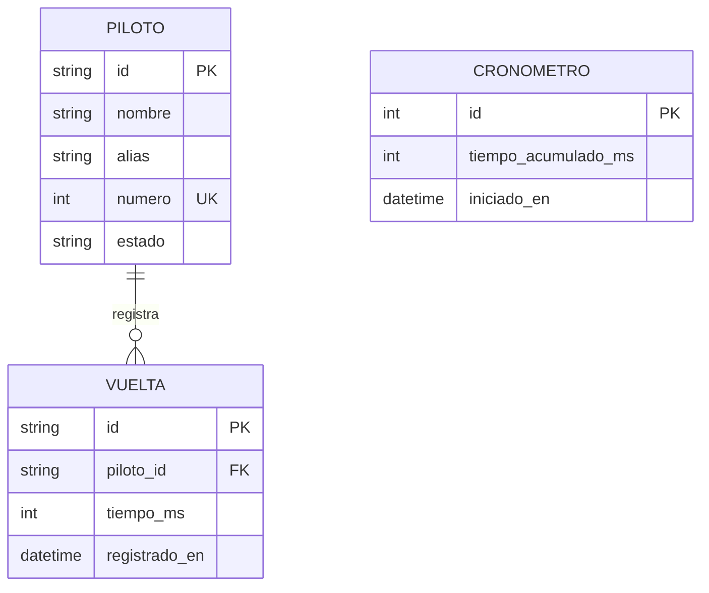

# Modelo relacional

El sistema ejecutable usa LocalStorage y objetos JSON, no un motor SQL. Este modelo relacional representa las mismas entidades para una eventual migración a una base de datos.

## Diagrama entidad-relación

## Entidades y restricciones

### PILOTO

| Atributo | Tipo lógico | Restricciones |
|---|---|---|
| `id` | texto | Clave primaria única generada por el navegador. |
| `nombre` | texto | Obligatorio, máximo 40 caracteres. |
| `alias` | texto | Obligatorio, máximo 30 caracteres. |
| `numero` | entero | Obligatorio, entre 0 y 999; único. |
| `estado` | enumeración | `activo`, `eliminado`, `penalizado` o `ganador`; por defecto `activo`. |

### VUELTA

| Atributo | Tipo lógico | Restricciones |
|---|---|---|
| `id` | texto | Clave primaria única. |
| `piloto_id` | texto | Clave foránea a `PILOTO.id`; cada vuelta pertenece a un piloto. |
| `tiempo_ms` | entero | Tiempo global acumulado en milisegundos, mayor o igual a cero al registrar. |
| `registrado_en` | fecha y hora | Instante de registro, guardado como milisegundos Unix. |

Si se lleva este modelo a SQL, se recomienda `ON DELETE CASCADE` para eliminar las vueltas al eliminar su piloto.

### CRONOMETRO

| Atributo | Tipo lógico | Restricciones |
|---|---|---|
| `id` | entero | Clave primaria; se usa un único registro global. |
| `tiempo_acumulado_ms` | entero | Tiempo consolidado al pausar o reiniciar. |
| `iniciado_en` | fecha y hora nullable | Marca Unix en ms; nula cuando está pausado. |

El tiempo visible es `tiempo_acumulado_ms + (ahora − iniciado_en)` mientras `iniciado_en` exista. En la aplicación, el estado se guarda como un objeto en la clave `cdm_clock`.

## Mapeo a LocalStorage

| Clave | Representación |
|---|---|
| `cdm_racers` | Arreglo de registros `PILOTO`. |
| `cdm_laps` | Mapa de `piloto_id` a arreglo de registros `VUELTA`. |
| `cdm_clock` | Registro singleton `CRONOMETRO` (`elapsed` y `startedAt`). |
