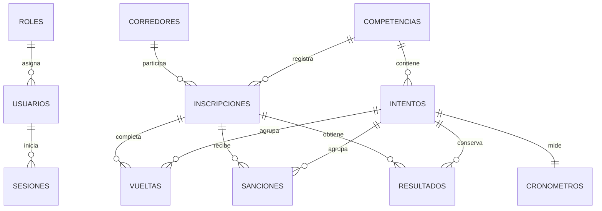

# Modelo relacional de carreras a pie

Cada inscripción relaciona competencia, corredor y dorsal. Un corredor solo puede tener una inscripción por competencia y los dorsales son únicos dentro de ella. Las vueltas, sanciones y resultados deben pertenecer a una inscripción y un intento de la misma competencia.

La distancia de vuelta pertenece a la configuración de la competencia. Las distancias recorridas y los ritmos se calculan a partir de vueltas válidas y tiempos ajustados. Las competencias migradas sin longitud conocida conservan ese dato como nulo.

Las trece tablas funcionales incluyen roles, usuarios, sesiones, corredores, competencias, inscripciones, intentos, cronómetros, vueltas, sanciones, clasificaciones, auditoría y configuración. Las tablas auxiliares documentan migraciones y copias previas a restauraciones. Para nombres físicos y endpoints consulta [DOCUMENTACION.md](../DOCUMENTACION.md).
